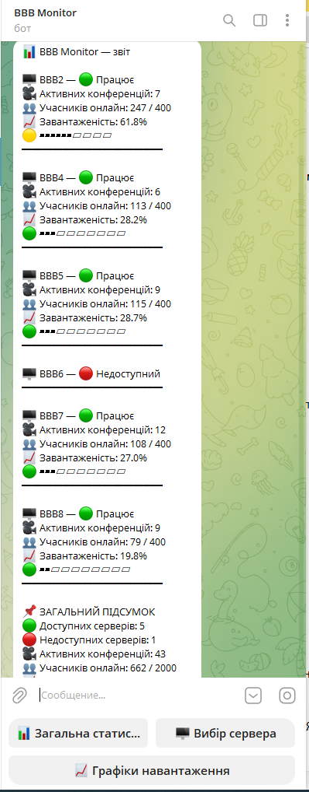
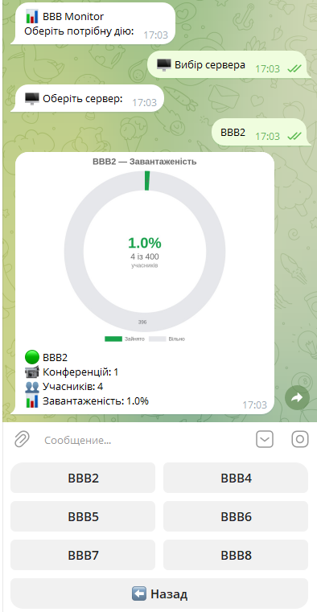
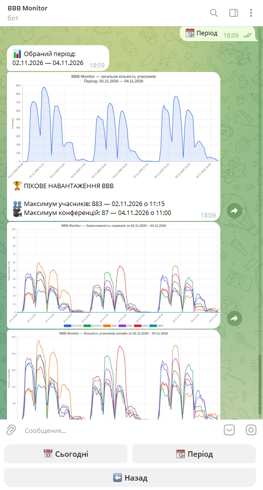

# 📊 BBB Monitor — Telegram Bot

A learning project for monitoring BigBlueButton servers using Telegram and n8n.

## 📌 About the Project

BBB Monitor is a Telegram bot designed to monitor BigBlueButton video conferencing servers.

The bot collects server statistics through the BigBlueButton API and displays the information in Telegram.

This project was created to practice workflow automation, API integration, and data processing.

## 🚀 Features

- 🖥 Monitoring of 6 BigBlueButton servers
- 🟢 Server availability status
- 🎥 Number of active meetings
- 👥 Number of online participants
- 📊 Server load percentage
- 📈 Historical server load charts
- 📋 Overall statistics across all servers
- 📅 Statistics for selected time periods
- 🔐 User access management

## 🛠 Technologies

- n8n — workflow automation
- Telegram Bot API — bot interface
- BigBlueButton API — server statistics
- JavaScript — data processing and formatting
- JSON and XML — API data formats

## ⚙️ How It Works

1. A user selects an option in the Telegram bot.
2. n8n processes the request.
3. The workflow requests statistics from BigBlueButton servers.
4. Server data is processed and formatted.
5. The bot sends the results to Telegram.

## 📱 Bot Menu

Main menu:

- 📊 Overall Statistics
- 🖥 Select Server

Server selection:

- BBB1
- BBB2
- BBB3
- BBB4
- BBB5
- BBB6

## 📸 Screenshots

### Telegram Bot — Main Menu

### Overall Server Statistics

### Individual Server Monitoring — BBB2

Detailed server statistics with a visual load indicator.

### Historical Server Load Charts

Monitoring server activity over a selected date range.

The bot displays:
- Total number of online participants over time
- Server load percentage for individual servers
- Number of participants on each server
- Peak participant and meeting counts

## ⚙️ n8n Workflow

The main workflow is available in JSON format.

[View n8n Workflow](workflows/bbb-monitor-public.json)

### Setup Instructions

1. Install and configure n8n.
2. Import the JSON workflow into n8n.
3. Create a Telegram bot using BotFather.
4. Configure Telegram credentials.
5. Configure BigBlueButton API access.
6. Create and configure the required data tables.
7. Configure the required supporting workflows.
8. Test the workflow before activating it.

**Note:** This is a sanitized portfolio version.
Additional configuration is required before use.

## 🔒 Security

API credentials, Telegram bot tokens, and private server information are not included in this repository.

## 📌 Project Status

Working learning project. Further improvements are in progress.

## 👩‍💻 Author

Marharyta Lytvynenko

GitHub: [marlit7](https://github.com/marlit7)
