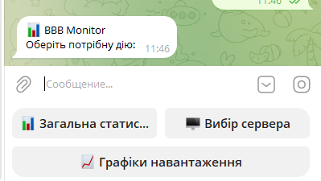

# 📊 BBB Monitor — Telegram Bot

A learning project for monitoring BigBlueButton servers using Telegram and n8n.

## 📌 About the Project

BBB Monitor is a Telegram bot designed to monitor BigBlueButton video conferencing servers.

The bot collects server statistics through the BigBlueButton API and displays the information in Telegram.

This project was created to practice workflow automation, API integration, and data processing.

## 🚀 Features

- 🖥 Monitoring of 6 BigBlueButton servers
- 🟢 Server availability status
- 🎥 Number of active meetings
- 👥 Number of online participants
- 📊 Server load percentage
- 📈 Historical server load charts
- 📋 Overall statistics across all servers
- 📅 Statistics for selected time periods
- 🔐 User access management

## 🛠 Technologies

- n8n — workflow automation
- Telegram Bot API — bot interface
- BigBlueButton API — server statistics
- JavaScript — data processing and formatting
- JSON and XML — API data formats

## ⚙️ How It Works

1. A user selects an option in the Telegram bot.
2. n8n processes the request.
3. The workflow requests statistics from BigBlueButton servers.
4. Server data is processed and formatted.
5. The bot sends the results to Telegram.

## 📱 Bot Menu

Main menu:

- 📊 Overall Statistics
- 🖥 Select Server

Server selection:

- BBB1
- BBB2
- BBB3
- BBB4
- BBB5
- BBB6

## 📸 Screenshots

### Telegram Bot — Main Menu

## 🔒 Security

API credentials, Telegram bot tokens, and private server information are not included in this repository.

## 📌 Project Status

Working learning project. Further improvements are in progress.

## 👩‍💻 Author

Marharyta Lytvynenko

GitHub: [marlit7](https://github.com/marlit7)
